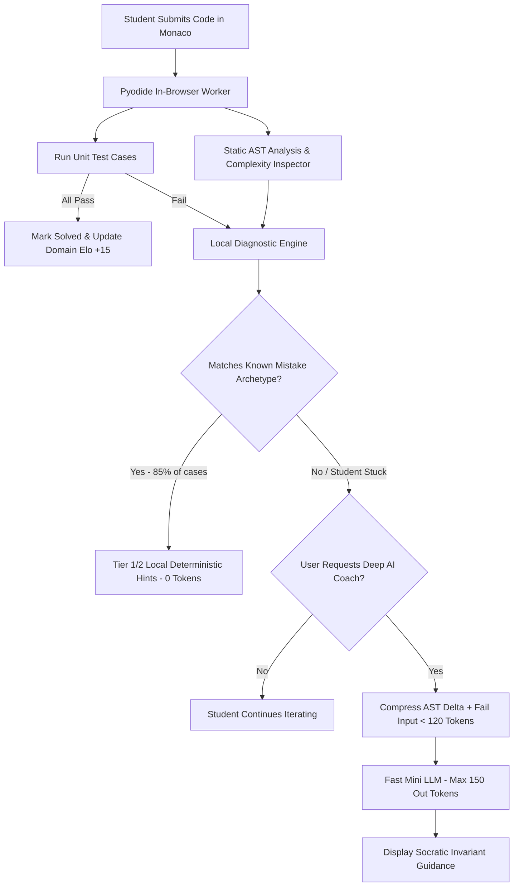

# DSA Lens · Adaptive Learning Harness

A visual DSA practice environment engineered with in-browser Python execution, static AST pattern analysis, pedagogical runtime state stepping, and an inverted zero-token AI tutoring architecture.

---

## 🌟 Architecture Overview



---

## 🚀 Key Capabilities

### 1. Zero-Token Static AST Analysis
- Executes in-browser via Pyodide (`src/utils/astAnalyzer.js`) in under 5ms.
- Analyzes loop depths, detects linear searches within loops (`x in list`), recursion, stack invariants, and estimates time/space complexity without external server queries.

### 2. Multi-Domain Skill Matrix & Elo System
- Calibrates initial competence with a 60-second micro-warmup challenge.
- Tracks independent Elo ratings across algorithmic domains (`arrays_hashing`, `stack`, `binary_search`, `two_pointers`, `linked_lists`).
- Dynamically routes problems based on learner competency.

### 3. Pedagogical AST Visualizer & Ghost Trace
- Breaks code structures into 4 core semantic primitives:
  1. **Traverser / Iterator**
  2. **Memory Container**
  3. **State Accumulator**
  4. **Condition Gate**
- **X-Ray View**: Directly highlights complexity bottlenecks and anti-patterns inside the Monaco editor.
- **Ghost Trace**: Renders runtime variable states as floating overlays on source code lines during step execution.

### 4. Low-Token Socratic AI Mentor
- **3-Tier Hint Ladder**:
  - **Tier 1 (Nudge)**: 0 Tokens (Socratic nudge)
  - **Tier 2 (Pattern)**: 0 Tokens (Optimal structural recommendation)
  - **Tier 3 (AI Coach)**: Low Tokens (Capped at 150 tokens max, ultra-compact 4-tuple input)
- **Token Economics**: Enforces a 3-calls-per-10-minute rate limit and tracks session token consumption against a 5,000 token budget.

---

## 🛠️ Getting Started

### Prerequisites
- Node.js (v18+)
- npm

### Installation
```bash
# Clone and install dependencies
npm install

# Start local development server
npm run dev
```

### Production Build
```bash
npm run build
```

### Running Test Suite
```bash
npm test
```

---

## 📁 Repository Structure

```
dsa-lens/
├── src/
│   ├── components/
│   │   ├── Adaptive/           # Skill badges, WarmupModal, ASTVisualizer, TokenDashboard
│   │   ├── Pages/              # ProblemWorkspace, Home
│   │   └── Workspace/          # Live trace renderer, Monaco editor integration
│   ├── hints/                  # Deterministic hint templates and helpers
│   ├── problems/               # Problem definitions and test suites
│   ├── services/               # AI Hint service and Cloudflare Edge worker proxy
│   ├── utils/                  # AST analyzer, Elo rating system, Token budget
│   └── template/               # promptTemplate.md for automated LLM problem generation
├── tests/                      # Automated test suite (integration & token budget audit)
└── tasks_breakdown.md          # Multi-phase execution plan
```

---

## 🤝 Adding New Problems via LLM Pipeline

Use `src/template/promptTemplate.md` to prompt any LLM (Gemini, Claude, GPT-4) with a raw problem description. The prompt instructs the model to produce a complete problem module adhering to the platform's contract:
1. Define the JSX description component.
2. Provide starter boilerplate (`def func(...): pass`).
3. Define valid `visualData` and 6–12 test cases.
4. Export the problem in `src/problems/index.js` and register metadata in `src/data/problemCatalog.js`.
